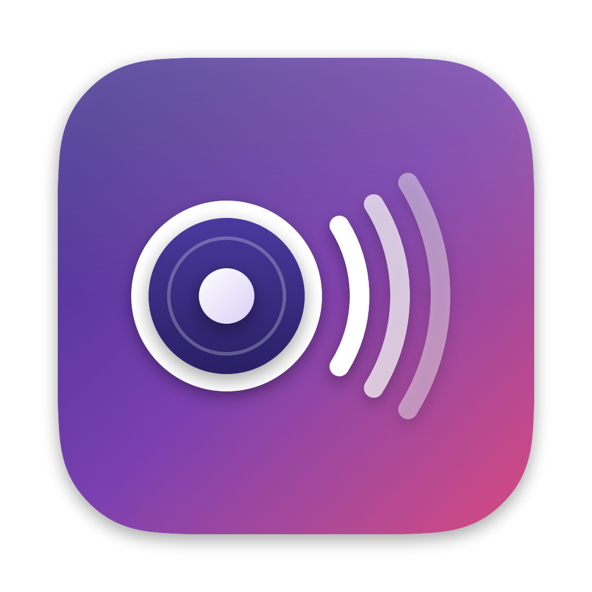

# Klang Player

A macOS music player (a window, the menu bar, or both) that plays an [Emby](https://emby.media) music library on network
speakers: **Loewe klang** and other Frontier Silicon speakers, and standard UPnP/DLNA
renderers such as Marantz/Denon (HEOS) receivers.

English and Russian UI (follows the system language, can be changed in Settings).

## Why

Loewe klang speakers have a UPnP renderer, but it doesn't work with Emby or other DLNA apps:

- The device description (`dd.xml`) lists no services, so control points can't find
  `AVTransport` ("Unable to find avCommands" in Emby).
- Over the network the speaker only accepts **MP3 and AAC**, not FLAC.
- AAC plays only as a complete `.m4a` file with the `moov` atom at the start, not as a live stream.

Klang Player works around all of that:

1. Downloads the original track from Emby and converts it to **AAC 320 kbps** with Apple's
   encoder (`afconvert`, 2–3 seconds per track). Hi-res files are resampled to 44.1/48 kHz.
2. Serves the file from a built-in HTTP server and drives the speaker over UPnP using the
   control URLs directly.
3. Converts the next tracks ahead and queues the next one with `SetNextAVTransportURI`,
   so tracks switch without a gap.

Speakers that accept FLAC (e.g. Marantz) get the **original files straight from Emby** —
no conversion, and the Mac isn't in the audio path.

## Features

- **Recent**: continue where you left off, albums you played lately, new in the library, playlists
- **Smart mixes** from a short description in English or Russian ("calm for work", "Russian 90s",
  "forgotten favorites"): Last.fm artist tags, decades, language, listening history
- **Discover**: new releases of your artists that you don't have yet, and artists similar to what you
  listen to most (Last.fm history + Deezer), with 30-second previews and "open in Apple Music / YouTube Music"
- **Statistics**: plays, approximate hours, top artists / albums / tracks for a month, a year or all time
- Albums (sorted by name or Last.fm popularity), artists with their popular tracks and similar artists,
  **folder browser** (play any folder recursively), search
- Queue: drag to reorder, shuffle what's next, repeat (queue / track), save as playlist, clear;
  **keeps playing similar music** when it ends; restored after restart
- Playlists: create, add tracks, albums or folders
- **Player window** with a sidebar and a Dock icon, the compact menu bar popover, or both (Settings → Mac); the window can be hidden to the menu bar
- **Loudness leveling** (EBU R128) for tracks converted for the speaker
- **Lyrics** from [LRCLIB](https://lrclib.net), timed lines follow the song, on-device translation (macOS 15+)
- **Last.fm** (your own free API key): scrobbling, ♥ as love, descriptions, popularity
- **Covers**: fill missing album covers from track pictures or exact Deezer / iTunes matches; saved to Emby
- Several speakers: switch from the main window, playback continues on the new one; turn the speaker off
- Speaker discovery over SSDP; finds the speaker again by its UDN if its IP changes
- Restarting the app doesn't stop the music: it picks up what the speaker is playing
- Floating cover card above all windows in three styles and sizes (scroll over it to change the volume)
- Menu bar: the track with ⏮ ⏯ ⏭; Dock menu and a Controls menu; macOS Now Playing and media keys; desktop widget
- Sleep timer; **phone remote** (a web page on the home network, protected by a secret link)
- Liquid Glass on macOS 26+
- Keyboard: Space play/pause, ←/→ seek, ⌘F search, ⌘↑/⌘↓ volume, Esc back

## Install

Download the DMG from [Releases](https://github.com/satsura/klang-player/releases) and drag the
app to Applications. The app isn't notarized: on first launch right-click it and choose
**Open**, or run `xattr -dr com.apple.quarantine /Applications/KlangPlayer.app`.

On first launch the app asks for the Emby server, your login and the speaker; macOS also asks
for **Local Network** access — allow it, otherwise speaker discovery doesn't work.

Sign in with your Emby username and password: with an API key Emby doesn't record play
history from the app (the app then marks played tracks itself, but there's no scrobbling).

## Build

Requires macOS 14+ and Xcode command line tools.

```sh
./build.sh                    # → ~/Applications/KlangPlayer.app
swift test                    # unit tests
./release.sh 1.2.0            # universal build, DMG, GitHub release
```

## Notes

- With Frontier speakers the Mac has to stay on while music plays (the speaker fetches
  converted files from it); the app keeps the Mac awake during playback.
- Tested with Loewe klang s3 (firmware `ir-cui-FS2340-0000-0181_V4.5.21`) and Marantz MODEL 60n.
- Frontier speakers are controlled through `fsapi` with the default PIN `1234`.
- Local API on port 47830: `/api/state`, `/api/art`, `POST /api/toggle|next|prev|volume|seek`.
  Answered for this Mac; from the network only with the phone remote on and its key.
  The widget also uses `klangplayer://toggle|next|prev|card` links.

## Debug flags

```sh
KlangPlayer --discover                    # list speakers on the network
KlangPlayer --relocate                    # find the current speaker again
KLANG_ALBUM="Name" KlangPlayer --prepare  # download + convert one track, print progress
KLANG_ALBUM="Name" [KLANG_SPEAKER=ip] KlangPlayer --selftest  # short playback test
KlangPlayer --window [x y] [--dark]       # show the UI in a regular window
KlangPlayer --preview [--card]            # fake a queue in the UI; the speaker isn't touched
```

## License

MIT
